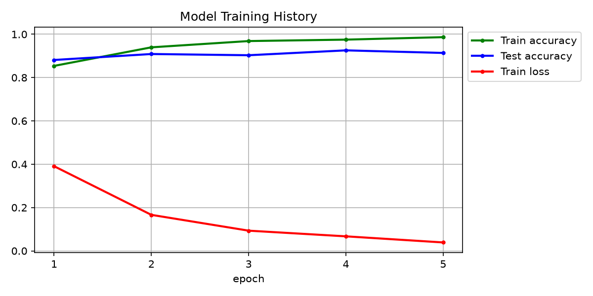
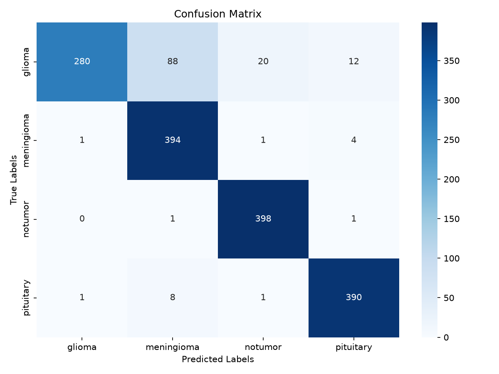
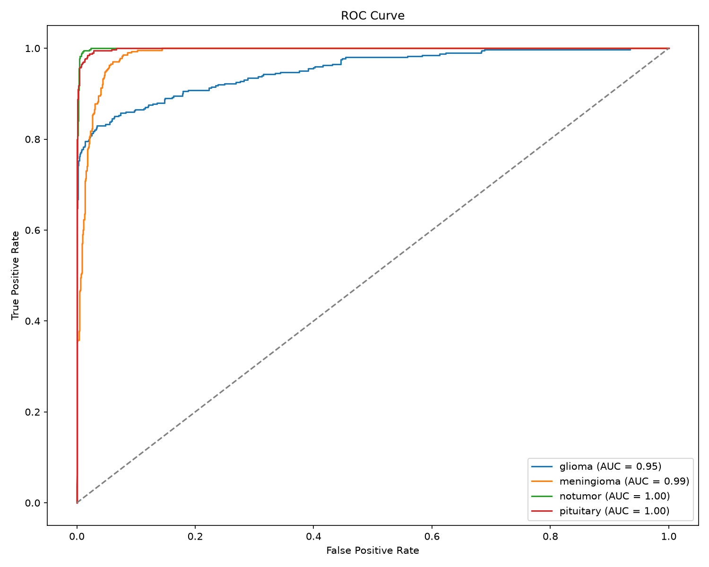

# BrainTumer — Brain Tumor MRI Classification (PyTorch)

A VGG16 transfer-learning classifier that detects and classifies brain tumors from MRI scans into
four categories — **glioma**, **meningioma**, **pituitary**, or **no tumor** — with a small Flask web app
for uploading a scan and getting a prediction.

## Results (5 epochs, 128×128, Apple MPS)

| Class       | Precision | Recall | F1   |
|-------------|-----------|--------|------|
| glioma      | 0.99      | 0.70   | 0.82 |
| meningioma  | 0.80      | 0.98   | 0.88 |
| notumor     | 0.95      | 0.99   | 0.97 |
| pituitary   | 0.96      | 0.97   | 0.97 |
| **Overall** | **0.93**  | **0.91** | **0.91** (accuracy 91 % on 1,600 test images) |

The main confusion is glioma → meningioma (see `docs/confusion_matrix.png`).

| Training history | Confusion matrix | ROC curve |
|---|---|---|
|  |  |  |

## Dataset

[Brain Tumor MRI Dataset (Kaggle)](https://www.kaggle.com/datasets/masoudnickparvar/brain-tumor-mri-dataset) —
7,200 JPEG images, balanced across classes.

```
data/
├── Training/   1,400 images per class (5,600)
│   ├── glioma/  meningioma/  notumor/  pituitary/
└── Testing/      400 images per class (1,600)
    └── glioma/  meningioma/  notumor/  pituitary/
```

`data/` is git-ignored; download the dataset and place it as above.

## Model

```
VGG16 (ImageNet weights, convolutional backbone only)
  └─ all layers frozen except block5 conv1–conv3 (fine-tuned)
Flatten → Dropout(0.3) → Linear(8192→128) → ReLU → Dropout(0.2) → Linear(128→4)
```

- Input: 128×128 RGB, pixel values scaled to [0, 1]
- Augmentation: random brightness / contrast ±20 %
- Loss: cross-entropy · Optimizer: Adam, lr 1e-4 · Batch 20 · 5 epochs
- Device: auto-selects Apple MPS → CUDA → CPU

## Setup

Python 3.10+.

**VS Code:** `Cmd+Shift+P` → *Python: Create Environment* → *Venv* → tick `requirements.txt`.

**Terminal:**
```bash
python3 -m venv .venv
source .venv/bin/activate        # Windows: .venv\Scripts\activate
pip install -r requirements.txt
python -c "import torch; print(torch.__version__, torch.backends.mps.is_available())"
```

## Usage

### 1. Train
```bash
python train.py                          # defaults: 5 epochs, batch 20, lr 1e-4
python train.py --epochs 10 --batch-size 32 --lr 5e-5
```
Shows a live progress bar with running loss/accuracy and prints test accuracy after every epoch.
The first run downloads VGG16 ImageNet weights (~530 MB) once.

Produces:
- `models/model.pt` — weights + class names
- `outputs/training_history.png`, `confusion_matrix.png`, `roc_curve.png`, `classification_report.txt`

| Flag | Default | Description |
|---|---|---|
| `--train-dir` / `--test-dir` | `data/Training` / `data/Testing` | dataset folders |
| `--epochs` | 5 | training epochs |
| `--batch-size` | 20 | images per batch |
| `--lr` | 1e-4 | Adam learning rate |
| `--workers` | 2 | DataLoader workers (use `0` if you hit multiprocessing errors) |
| `--seed` | 42 | random seed |
| `--out` | `models/model.pt` | checkpoint path |

### 2. Run the web app
```bash
python main.py
```
Open <http://127.0.0.1:5000>, upload an MRI image, and the page shows the predicted class with a
confidence score. Try any image from `data/Testing/`.

## Project structure

```
BrainTumer/
├── model.py              model architecture, device selection, save/load checkpoint
├── train.py              training loop + evaluation (report, confusion matrix, ROC)
├── main.py               Flask upload → predict app
├── templates/index.html  web UI (Bootstrap)
├── requirements.txt
├── models/               trained checkpoint (git-ignored)
├── outputs/              plots and classification report (git-ignored)
├── docs/                 result plots used in this README
├── data/                 dataset (git-ignored)
└── reference/            original TensorFlow notebook, app and requirements
```

## Possible improvements

- ImageNet mean/std normalisation instead of plain [0, 1] scaling
- A validation split with early stopping / learning-rate scheduling
- More augmentation (flips, small rotations) to lift glioma recall
- Larger input size (224×224) or a lighter backbone (ResNet18 / EfficientNet-B0)
- Grad-CAM heatmaps in the web app to show *where* the model is looking

## Disclaimer

Educational project only — not a medical device and not intended for clinical use.
